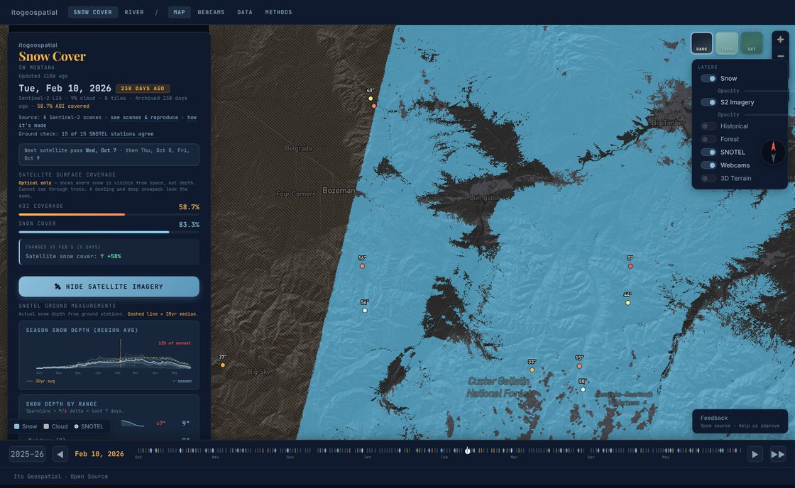
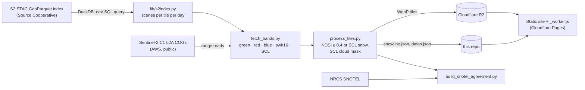

# Line Network

Open, reproducible outdoor-conditions maps for Montana, built from free public data.

**[Snowline](https://line.itogeospatial.com/snow)** is the first product. It maps snow cover across SW Montana, from the Bridgers to the Beartooths, with Sentinel-2 imagery, and checks every map against SNOTEL ground stations. RiverLine (river conditions) and SkyLine (mountain weather) are in progress in this repository.



| | |
|---|---|
| **Map** | [line.itogeospatial.com/snow](https://line.itogeospatial.com/snow): the **latest view** (every pixel's most recent clear look from the last 10 days of passes, so no half-covered days), every pass of the season on a timeline, and shareable links (`#date=2026-02-10&map=10/45.5/-111.0`) |
| **Data** | [/snow/metadata.html](https://line.itogeospatial.com/snow/metadata.html): every Sentinel-2 scene behind the map with links to the files, a *reproduce* button on each, and per-tile snow history since 2018 |
| **Methods** | [/snow/methods.html](https://line.itogeospatial.com/snow/methods.html): the algorithm, the SNOTEL agreement score, and where it goes wrong |
| **Terrain** | Shading from USGS 3DEP 1 m lidar under every snow map (newest survey wins) |
| **Open data** | [/snow/stac/catalog.json](https://line.itogeospatial.com/snow/stac/catalog.json): every map as Cloud-Optimized GeoTIFFs (0 ground, 1 snow, 2 cloud, 3 no data) in a static STAC catalog |

## How it works



* **No API servers and no keys for the imagery.** Scene search is a DuckDB query against static Parquet files: the [S2 STAC GeoParquet index](https://research.taylorgeospatial.org/s2-stac-geoparquet/) by Taylor Geospatial / TGE Labs, which mirrors Element 84's Earth Search.
* **Every number traces to a source.** Each map lists the scene ids it was made from. The Data page links each scene to its Cloud-Optimized GeoTIFF.
* **Automated.** A GitHub Action rebuilds the pass list and SNOTEL data every morning. A second Action turns each new clear pass into a map.

## Reproduce it yourself

Find the Sentinel-2 scenes behind any Snowline date:

```python
import duckdb
duckdb.sql("""
  INSTALL httpfs; LOAD httpfs; SET s3_region='us-west-2'; SET s3_url_style='path'; SET TimeZone='UTC';
  SELECT id, _tile, "eo:cloud_cover", "s2:snow_ice_percentage",
         json_extract_string(assets, '$.green.href')  AS green,
         json_extract_string(assets, '$.swir16.href') AS swir16
  FROM read_parquet('s3://us-west-2.opendata.source.coop/tge-labs/s2-stac-geoparquet/sentinel-2-c1-l2a/year=2026/*.parquet')
  WHERE _tile IN ('12TUR','12TVR','12TWR') AND datetime >= '2026-04-19' AND datetime < '2026-04-20'
""").show()
```

Rebuild a map from the raw imagery. One tile is about 0.5 GB of range reads; a full date is several GB and a few minutes:

```bash
python -m venv .venv && source .venv/bin/activate
pip install -r snowline/pipeline/requirements.txt
python -m lib.s2index                                         # smoke test: latest scenes for 12TVR
python snowline/pipeline/fetch_bands.py --date=2026-04-19 --tiles=12TVR
python snowline/pipeline/process_tiles.py --date=2026-04-19
python tools/dev_server.py                                    # http://localhost:8787/snow/#date=2026-04-19
```

## Repository

| Path | What |
|---|---|
| `lib/` | Shared Python: `s2index.py` (scene search on the GeoParquet index), `aoi.py` (areas and tiles) |
| `snowline/pipeline/` | Snowline's pipeline. Every script runs on its own and has a `--help`. |
| `snowline/site/` | The static site: map, Data page, Methods, webcams |
| `_worker.js` | Cloudflare edge worker: routes `/snow` and `/river`, serves tiles from R2, proxies webcams |
| `riverline/` | RiverLine: river gauges, forecasts and history (in progress) |
| `skyline/` | SkyLine: mountain weather (planned) |
| `tools/dev_server.py` | Local preview without Cloudflare |
| `docs/` | Setup notes and images |

See [CONTRIBUTING.md](CONTRIBUTING.md) to work on it and [AGENTS.md](AGENTS.md) if you are an AI agent.

## Licence and credits

Code: [Apache-2.0](LICENSE). Data: each source keeps its own terms, listed in [DATA_LICENSE.md](DATA_LICENSE.md).

Contains modified Copernicus Sentinel data, processed by ESA. Scene index by [Taylor Geospatial / TGE Labs](https://research.taylorgeospatial.org/s2-stac-geoparquet/) from [Element 84 Earth Search](https://element84.com/earth-search/). Snow depth from USDA NRCS SNOTEL. Built by [Ito Geospatial](https://itogeospatial.com) in Bozeman, Montana.

> Snowline shows where snow is visible from space. It is not an avalanche forecast. Read the [Gallatin National Forest Avalanche Center](https://www.mtavalanche.com/) before going into avalanche terrain.
